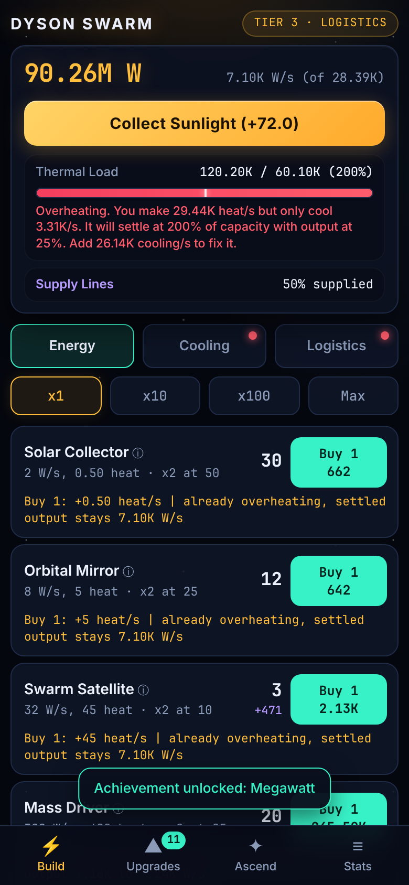
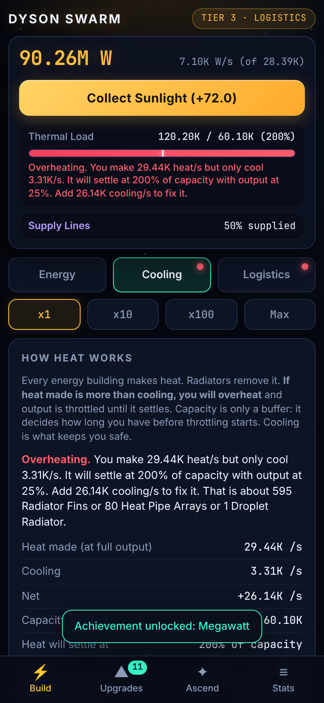
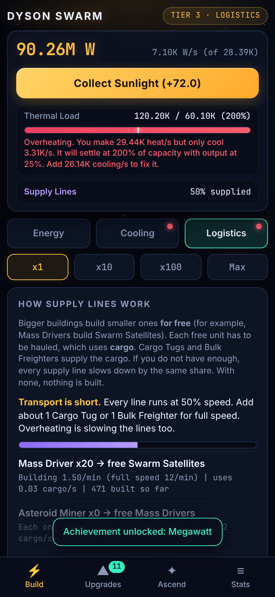
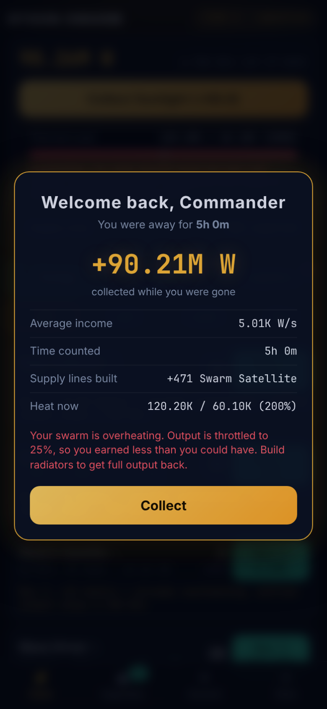

# Dyson Swarm

An idle game about building a Dyson swarm, starting with a single rooftop solar panel. It plays like AdVenture Capitalist, except each tier adds a rule of its own instead of just bigger numbers.

It's one HTML file with no dependencies and no build step. Open `index.html` and play. It works on desktop and phones.

<p>
  
  
  
  
</p>

## How it plays

- **Build.** Click to collect sunlight, then buy collectors, mirrors, satellites, and eventually mass drivers and planet disassemblers. Buy in batches of 1, 10, 100, or the most you can afford. Every 10, 25, 50, 100, 200, 300 and 400 you own, that building's output doubles.
- **Heat.** Every building makes heat and radiators remove it. If you make more heat than you can shed, output is throttled until things settle. The game shows where your heat is heading and what each purchase would do to it before you buy.
- **Supply lines.** Bigger buildings build smaller ones for free, but each unit needs cargo hauled by tugs and freighters. If transport falls short, every line slows down by the same share.
- **Ascend.** Reset for Dark Matter, which gives a permanent output bonus and buys permanent upgrades.
- **Offline progress.** Close the game and come back later. You get a summary of how long you were away and what the swarm earned, up to 8 hours.

Progress saves in the browser. You can export and import saves from the Stats tab.

## Under the hood

The game is a single `index.html` with five sections, in order: data, state, engine, save, UI, and main loop.

- Content is data. Buildings, upgrades, achievements, and Dark Matter upgrades are tables at the top of the script, so adding one means adding a row.
- All production uses delta time. Offline progress runs the same simulation as live play, in larger steps, and a test checks that the two agree.
- Heat settles on a smooth curve instead of a hard cap, so output never drops to zero.
- Saves are versioned, and older saves are migrated when loaded.

## Run the tests

```
npm install jsdom
node tests/smoke.js
```

The test loads the game in a simulated browser and checks buying, heat, upgrades, supply lines, Ascend, saving and loading, offline progress, and old save migration.

## Tuning

All balance numbers are in the data section of `index.html`: `BUILDINGS`, `HEAT`, `UPGRADES`, `PRESTIGE`, `DM_UPGRADES`, `ACHIEVEMENTS`.

## Roadmap

- Rival swarms that compete for the same stars
- Balance pass and more achievements

`PROGRESS.md` has the full status and known balance issues. `DYSON_SPEC.md` has the design notes.
